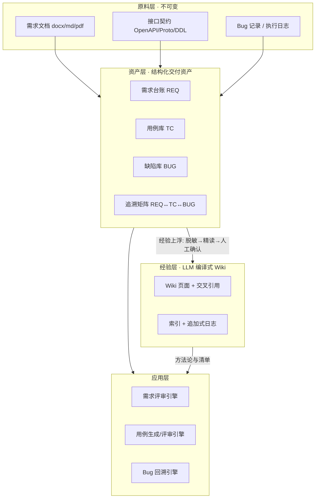
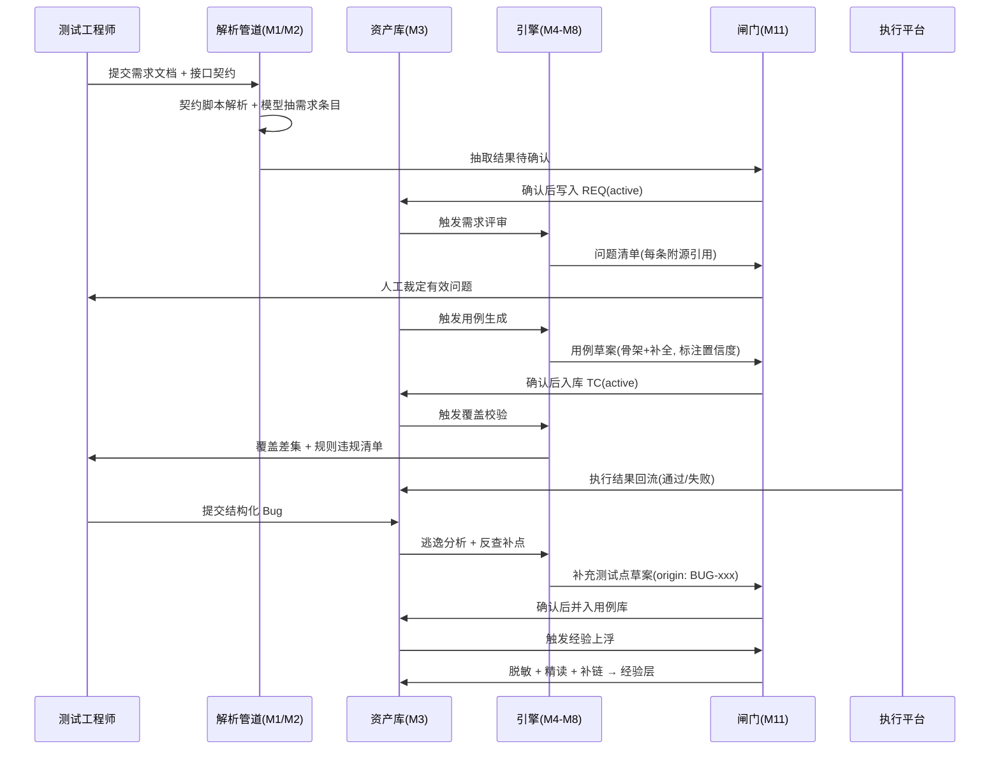

# LLM-Wiki 需求—测试闭环方案

> **文档用途**：提交公司内部评审，用于判断方案（1）是否技术可行；（2）是否适配公司现有知识库框架。
> **阅读建议**：评审方先读第 0 章结论摘要与第 8 章评审关注点清单；技术评估方重点看第 2、3、4、5 章；指标口径见第 6 章。
> **文档约定**：所有需要公司侧确认的前置假设集中在第 1.4 节，未确认项一律标记 `[待确认]`，不作为结论依据。

---

## 0. 结论摘要

### 0.1 一句话结论

以 **LLM 编译式 Wiki 作为经验层**、以**结构化资产库作为交付层**，构建「需求评审 → 测试用例生成 → 用例评审 → Bug 回溯补点」的闭环——**技术上成立**，但成立的前提是把 LLM 的角色限定为**翻译器与差异发现器**，而不是决策者。

### 0.2 三条核心判断

1. **闭环不是一个环，是三个成熟度不同的环。**
   - 环 A（需求 ↔ 用例）：技术成立，但结论必须由人下 —— 系统只能产出问题清单与覆盖率，不能产出「通过」。
   - 环 B（Bug → 测试点）：最容易闭合、ROI 最高 —— 输入是已经发生的事实，不依赖模型推测。
   - 环 C（自动回写）：当前不成立，必须有闸门，否则用例库会被污染成噪声堆。

2. **真正的瓶颈不在「生成」，而在两头：输入的结构化程度 + 结果回写的验证。**
   大量同类项目失败于「用例生成得很热闹，但没人跑、没人确认、下次不留痕」。

3. **闭环的地基是三向追溯 ID（REQ ↔ TC ↔ BUG），不是模型能力。**
   没有稳定的 ID 关联，「闭环」只是三段互不相干的 LLM 输出拼在一起。

### 0.3 建议落地顺序

| 优先级 | 阶段 | 为什么 |
|---|---|---|
| P0 | 三向追溯矩阵 | 纯结构化，不用模型；没有它后面全是空中楼阁 |
| P1 | Bug 反查补测试点 | 输入是既成事实，最快见效 |
| P2 | 接口契约 → 用例骨架 | 字段约束可直接推导，确定性最高 |
| P3 | 需求评审问题清单 | 检查项可枚举，只输出问题不下结论 |
| P4 | 用例覆盖差集与冗余检测 | 依赖 P0 的追溯质量 |
| P5 | 全自动闭环 | 前四条稳定运行后再谈 |

> **注**：在 A1（模型数据出域受限）与 A7（执行结果不回流）均不成立的约束下，推荐范围收敛为 **P0 + P1 + P2 + P4 的「本地确定性内核」**，详见第 11 章。

### 0.4 明确不做的事（边界）

- 不判定需求业务逻辑的正确性（系统只能发现缺失、不一致、歧义）。
- 不做无人工闸门的自动回写。
- 不把真实业务数据、原始内部文档纳入可检索的经验层。
- 不替代缺陷管理系统的流程职能（只做分析与反查）。

### 0.5 约束现状与推荐范围

已确认两项前置约束不成立：

- **A1 不成立**：模型调用受数据出域限制，无内网/私有化模型可用（或需逐次审批）。
- **A7 不成立**：执行平台无法回流用例的通过/失败结果。

**结论：本方案不因此失效，但推荐范围收敛为 P0 + P1 + P2 + P4 组成的「本地确定性内核」。**
该内核的三个特征：

1. **零数据出域** —— 全部环节由本地脚本完成，模型不接触内部原文；
2. **零平台回流依赖** —— 闭环信号来自缺陷记录而非执行平台接口；
3. **可离线运行** —— 不依赖任何外部服务即可产出价值。

降级路径与影响面判定见第 11 章。

---

## 1. 目标与范围

### 1.1 要解决的问题

| 现状痛点 | 本方案对应能力 |
|---|---|
| 需求评审靠经验，遗漏靠事后发现 | 维度缺席检测 / 历史一致性 / 变更影响面 |
| 用例编写重复劳动多，边界靠手感 | 契约驱动的边界与等价类自动推导 |
| 用例覆盖度说不清，评审变成通读 | 需求↔用例双向追溯矩阵，覆盖差集可视化 |
| Bug 修完就结束，经验不回流 | 逃逸原因分类 + 反查补测试点 |
| 经验散落在个人手里 | LLM 编译式 Wiki 沉淀为可引用图谱 |

### 1.2 闭环范围

```
需求文档/接口文档 → 解析入库 → 需求评审 → 用例生成 → 用例评审
                                                ↑              ↓
                                          测试点回补  ←  Bug 分析回溯
```

### 1.3 交付物定义

| 交付物 | 形态 | 归属层 |
|---|---|---|
| 需求台账 | 一条一文件 / 一行记录，含 REQ-ID | 资产层 |
| 接口契约索引 | 结构化解析结果（字段/约束/枚举） | 资产层 |
| 用例库 | TC-ID + 追溯字段 + 步骤与预期 | 资产层 |
| 缺陷库 | BUG-ID + 根因 + 逃逸阶段 | 资产层 |
| 追溯矩阵 | REQ ↔ TC ↔ BUG 关联表 | 资产层 |
| 经验 Wiki | 交叉引用页面 + 索引 + 日志 | 经验层 |

### 1.4 前置假设清单（`[待确认]`，评审需逐条核对）

| 编号 | 假设 | 若不成立的影响 |
|---|---|---|
| A1 | 公司模型可**内网/私有化**调用，数据不出域 `[已确认不成立]` | **不致命**——确定性环节不受影响，语义环节走降级路径，见第 11.2 节 |
| A2 | 需求文档有稳定产出流程，含可识别的验收标准 `[待确认]` | 环节 ① 退化，整个闭环退化为文档摘要 |
| A3 | 接口有**机器可读契约**（OpenAPI / Proto / DDL）`[待确认]` | 边界值用例失去唯一可靠来源 |
| A4 | 存在 ≥6 个月的历史需求、用例、Bug 记录 `[待确认]` | 需求评审的「历史一致性」无比对基准；无 few-shot 样本 |
| A5 | Bug 记录可补全结构化字段（根因 / 发现阶段 / 关联需求）`[待确认]` | 环节 ⑤ 无法反查，只能做无差别文本摘要 |
| A6 | 存在可投入的**人工闸门人力** `[待确认]` | 闸门是隐性成本，缺失则质量不可控 |
| A7 | 执行平台（CI / 测试平台）可回流通过失败结果 `[已确认不成立]` | **可替代**——改用缺陷记录作为事后执行信号，闭环仍成立，见第 11.3 节 |
| A8 | 公司知识库允许挂载新域或提供 API 接入 `[待确认]` | 需改走并列式部署（见 2.4） |

> **A7 是最容易被低估的一条条件**，建议评审时优先确认。

---

## 2. 总体架构

### 2.1 四层架构

| 层 | 职责 | 谁写 | 可变性 |
|---|---|---|---|
| **原料层** | 需求文档、接口契约、Bug 记录、执行日志 | 系统采集 / 人工投放 | **不可变**（只增不改，是事实基准） |
| **资产层** | 需求台账 / 用例库 / 缺陷库 / 追溯矩阵 | 解析管道 + 模型（默认 draft） | 高频演进，走闸门 |
| **经验层** | LLM 编译的 Wiki：方法论、踩坑、选型依据 | LLM 精读编译 + 人工确认 | 低频演进，交叉引用已就位 |
| **应用层** | 评审、生成、覆盖分析、回溯的服务入口 | 引擎 | 无状态 |



### 2.2 为什么必须分「资产层」和「经验层」

这是本方案**最关键的结构决策**，直接决定与公司知识库框架的适配方式。

| 维度 | 资产层（需求/用例/Bug） | 经验层（编译式 Wiki） |
|---|---|---|
| 内容性质 | 真实项目数据，带项目标识 | 脱敏后的通用方法与模式 |
| 写入方式 | **批量、机器写入** | **单源精读、人工确认后编译** |
| 内容边界 | 内部资产，权限受控 | 可跨项目复用的知识 |
| 更新频率 | 每日多次 | 每日 1–2 页上限 |
| 检索需求 | 精确查询（按 ID / 状态 / 关联） | 语义关联（按主题 / 标签 / 交叉引用） |

**若把两者混在同一个库中**，会同时出现两个后果：① 真实业务数据进入本应脱敏的通用知识层，形成数据越权；② 精读编译的成本模型被高频写入冲垮，最终两边都维护不下去。

两者之间只允许**经验单向上浮**（脱敏 → 精读 → 人工确认 → 补链），原始资产不过桥。

### 2.3 与公司现有知识库框架的关系（适配性说明）

本方案**不要求替换或改造公司现有知识库**，只要求它能以三种模式之一承载：

| 模式 | 形态 | 适配前提 | 建议场景 |
|---|---|---|---|
| **模式 A · 并列式** | 方案独立部署，与公司 KB 只做单向经验推送 | 无需任何改造 | 公司 KB 为黑盒/无 API；试点阶段 |
| **模式 B · 挂载式** | 作为一个「需求测试域」挂进公司 KB，复用其权限与检索 | 公司 KB 支持新增空间/域 `[A8]` | 长期方案，推荐 |
| **模式 C · 嵌入服务式** | 只把三个引擎（评审 / 生成 / 覆盖）作为服务接入研发流程，不建独立库 | 公司 KB 已足够，只缺分析能力 | 已成熟 RAG 平台的场景 |

**选型判据**：
- 若公司 KB 已有成熟 RAG 且检索质量可接受 → 选 **C**（避免重复建设，摩擦最小）。
- 若公司 KB 无 API、由其他团队掌管 → 选 **A**（试点验证价值，不依赖协调）。
- 若公司 KB 支持扩展且希望沉淀为组织资产 → 选 **B**。

> 三种模式共用同一套引擎与数据模型，切换成本主要在权限对接与索引同步，**不影响核心逻辑**。

### 2.4 权限与安全设计（公司环境必答项）

| 关注点 | 设计 |
|---|---|
| 数据出域 | 模型调用走内网网关 / 私有化部署；不调用外部 SaaS API `[A1 已确认不成立]` → 按 **11.2** 执行不出域降级：本地脚本承担全部确定性部分，模型仅接收脱敏占位化摘要，且需审批与留痕 |
| 分级权限 | 原料层与资产层继承公司目录权限；经验层为跨项目通用知识，独立授权 |
| 站点隔离 | 内部资产**不进任何公开站点**；过滤动作必须在构建期完成，不能在前端做 |
| 留痕审计 | 每次模型生成记录：调用人、模型版本、参数、输入摘要、产出、确认人 |
| 脱敏 | 进经验层前强制脱敏：去项目名、产品名、真实域名/接口地址、账号、业务数据 |

> **实现要点**：`publish` 之类的可见性开关**必须在构建脚本里过滤**。前端过滤意味着内容已下发到浏览器，等同于已公开。

---

## 3. 核心模块

### 3.1 模块总览

| 编号 | 模块 | 类型 | 是否用模型 | 产出 |
|---|---|---|---|---|
| M1 | 契约解析器 | 确定性 | **否** | 字段/类型/约束/枚举 结构化索引 |
| M2 | 需求条目化器 | 半自动 | 是 | REQ 条目（含验收标准） |
| M3 | 需求台账 | 存储 | 否 | REQ 库 + 版本历史 |
| M4 | 需求评审引擎 | 半自动 | 是 | 评审问题清单（附源引用） |
| M5 | 用例生成引擎 | 混合 | 部分 | 测试点 + 用例草案 |
| M6 | 用例评审引擎 | 确定性 | 否 | 覆盖差集 + 规则违规清单 |
| M7 | 缺陷分析模块 | 半自动 | 是 | 逃逸原因分类 |
| M8 | 测试点回补引擎 | 半自动 | 是 | 补充测试点草案 |
| M9 | 经验编译管道 | 半自动 | 是 | Wiki 页面 + 交叉引用 |
| M10 | 索引与检索 | 确定性 | 否 | 分层索引 / 标签索引 / 全文 |
| M11 | 闸门与审计 | 流程 | 否 | 状态流转与留痕 |

### 3.2 逐模块说明

#### M1 契约解析器（确定性，不用模型）

- **输入**：OpenAPI 3.x / Swagger 2.0 / Proto / DDL
- **输出**：结构化契约索引 —— `{接口, 字段, 类型, required, enum, 范围, pattern, 枚举值}`
- **实现要点**：纯脚本解析，**禁止用模型**。模型在这里只会引入不确定性，而这是后续所有边界值用例的唯一可靠来源。
- **降级**：契约缺失约束（如只写字段名不写 `required`）时，标记为「契约不完整」，生成阶段必须把推断项隔离标注。

#### M2 需求条目化器（半自动）

- **输入**：需求文档（docx / md / pdf）
- **输出**：`{REQ-ID, 标题, 验收标准[], 约束[], 依赖接口[], 变更点}`
- **实现要点**：
  - 模型只做**抽取**，不做**理解**。抽取失败率远低于判断失败率。
  - **必过人工闸门**：解析后先向提交人复述 3–5 条关键要点，确认无误才落库。
  - 一条需求一个稳定 ID，ID 不复用、不随标题变化。
- **失败模式**：验收标准本身写得含糊 → 抽取结果同样含糊。此时应输出「验收标准不可判定」而不是编造。

#### M3 需求台账

- **存储形态（推荐）**：Markdown + 结构化 frontmatter，构建期生成索引；或直接落表
- **必填字段**：`req_id` / `title` / `acceptance[]` / `status` / `version` / `sources`
- **实现要点**：字段即契约。字段结构变更需走独立的 schema 变更流程并同步下游解析，不能各处打补丁。

#### M4 需求评审引擎（半自动）

三类**可枚举**的检查，全部有据可查：

| 检查项 | 做法 | 为什么可靠 |
|---|---|---|
| 维度缺席检测 | 用固定 checklist 逐维度核对（内容来源 / 规模频率 / 场景实现 / 检索交互 / 治理维护） | 是枚举，不是判断 |
| 历史一致性 | 检索历史需求库，比对新旧口径是否冲突 | 有原文可比对 |
| 变更影响面 | 需求 → 接口 / 表 / 上下游 的映射扩散 | 走的是关系图，不是语义猜测 |

- **硬约束**：**每条结论必须附源引用（REQ-ID + 原文片段），无引用不入清单。**
  这是防「幻觉一致」（模型声称与某条不存在或不相关的需求冲突）的唯一有效手段。
- **输出定位**：评审**问题清单**，不是评审**结论**。系统提问，人下判断。

#### M5 用例生成引擎（混合）

**核心原则：骨架靠推导，血肉靠模型。**

| 部分 | 来源 | 内容 |
|---|---|---|
| 骨架（确定性） | 契约 + 规则 | 字段类型与约束 → 等价类 / 边界值；枚举 → 判定表；状态字段 → 状态迁移覆盖；必填组合 → 正交或两两组合 |
| 血肉（模型） | 模型 + 历史用例 few-shot | 业务语境命名、跨接口场景串联、异常链路（超时 / 重试 / 幂等 / 并发）、非功能项 |

- **历史用例库的作用**：做 few-shot 样本。这是用例库最实际的用途，效果优于纯 prompt。
- **强制标注**：所有模型推断的断言标 `confidence` 与 `needs-verification`，供评审聚焦。
- **最危险的失败模式**：契约不完整时，模型会**编造看起来合理的边界值**。因为「看起来是对的」，这类错误最难被发现 —— 必须靠标注隔离。

#### M6 用例评审引擎（确定性，可做门禁）

| 能力 | 可做性 | 说明 |
|---|---|---|
| 需求 ↔ 用例双向追溯差集 | ✅ 可算 | 无用例覆盖的需求条目 = 漏测点；无需求来源的用例 = 冗余或需求缺项 |
| 规则校验 | ✅ 可算 | 前置条件缺失、预期结果不可判定、步骤与预期不一致 |
| 语义覆盖度 | ❌ 不可算 | 两条用例文字不同但实质测同一件事 —— 只能标注给人看 |
| 语义冗余检测 | ⚠️ 半自动 | 可用相似度召回候选，人工裁定 |

- 这是**唯一可完全脚本化、可进 CI 做门禁**的环节。

#### M7 缺陷分析模块

- **前置成本在输入侧**：Bug 记录必须结构化 —— 现象 / 根因 / 发现阶段 / 关联 REQ-ID / 是否回归漏测。一次性建好，长期受益。
- **逃逸原因分类**建议口径：漏需求 / 漏场景 / 漏数据 / 环境差异 / 回归缺失 / 需求变更未同步。
- **产出**：分类统计 + 分布趋势，用于反推测试策略短板（哪个分类占比高，就补哪一类测试点）。

#### M8 测试点回补引擎

- **流程**：逃逸原因分类 → 反查「当时缺哪条用例能拦住」→ 生成补充测试点草案。
- **铁律**：**补点必须人工确认后入库，并标记 `origin: BUG-xxx`。**
  否则会把「这个 Bug 的特定场景」当成通用规则写进用例库，几百条之后用例库变成噪声堆。
- 这是**ROI 最高**的一环：输入是已发生的事实，不依赖模型推测。

#### M9 经验编译管道

- **触发**：闸门确认后的资产 → 抽取可复用模式 → 脱敏 → 编译为 Wiki 页 → 补全交叉引用 → 更新索引与日志。
- **编译原则**：**单源精读**。一次只处理一个源，批量灌入会牺牲交叉引用质量，而交叉引用正是经验层的核心价值。
- **质量约束**：
  - 每个页面必须有出链（至少 2 条），否则视为尚未接入图谱；
  - 概念冲突必须显式标 `superseded` 并指向新页，不允许静默覆盖；
  - 低置信度内容必须显式标注待验证。
- **规模控制**：每日编译上限 1–2 页。这是有意设的成本闸门 —— 经验层追求质量而非数量。

#### M10 索引与检索

| 检索类型 | 承载 | 适用 |
|---|---|---|
| 精确查询 | 结构化索引 / SQL | REQ/TC/BUG 按 ID、状态、关联查询 |
| 分层索引 | 目录 + 标签 | 经验层千页以内 |
| 全文检索 | 关键词 | 兜底 |
| 语义检索 | 向量（可选） | 仅用于**查重与召回辅助**，不作为主检索 |

> **不要一开始就引入向量库**。结构化资产用结构化查询，语义相似度只在「用例查重、需求相似召回」这两个场景下才有必要。

#### M11 闸门与审计（横切）

| 闸门 | 位置 | 动作 |
|---|---|---|
| G1 | 需求落库前 | 提交人确认抽取结果 |
| G2 | 评审清单产出后 | 评审人裁定有效问题 |
| G3 | 用例入库前 | 用例评审人确认 |
| G4 | 测试点回补前 | 确认并标记来源 Bug |
| G5 | 经验上浮前 | 脱敏检查 + 编译确认 |

**状态机**：所有自动生成内容默认 `draft`，经确认后转 `active`；被推翻的转 `superseded` 并保留溯源。

---

## 4. 数据流转

### 4.1 端到端流程



### 4.2 每步产物与存储位置

| 步骤 | 输入 | 输出 | 落点 |
|---|---|---|---|
| ① 契约解析 | OpenAPI / DDL | 字段约束索引 | 资产层 |
| ② 需求条目化 | 需求文档 | REQ 条目（draft） | 资产层 |
| ③ 需求评审 | REQ 条目 + 历史需求 | 问题清单（附引用） | 应用层，不落库 |
| ④ 用例生成 | REQ + 契约 + 历史用例 | TC 草案 | 资产层 |
| ⑤ 用例评审 | REQ + TC | 覆盖差集 + 违规清单 | 应用层 |
| ⑥ 执行回流 | CI 结果 | 通过/失败记录 | 资产层 |
| ⑦ Bug 分析 | 结构化 Bug | 逃逸分类 | 资产层 |
| ⑧ 测试点回补 | 逃逸分类 | 补充测试点（草案） | 资产层 |
| ⑨ 经验上浮 | 已确认资产 | Wiki 页面 | 经验层 |

### 4.3 关键：闭环在哪里真正「闭合」

```
生成 → 评审 → 入库 → 执行 → 结果回流 → 反哺生成策略
                        ↑
                  少了这一步就是开环
```

**只有第 ⑥ 步（执行结果回流）存在，闭环才成立。** 否则系统产出的是一批从未被验证过的文档，价值等同于批量生成器。

---

## 5. 实现要点

### 5.1 不用模型的地方，坚决不用

| 场景 | 理由 |
|---|---|
| 契约解析 | 解析器 100% 确定，模型只会引入不确定性 |
| 覆盖度计算、追溯矩阵 | 纯关系运算，可复现、可审计 |
| ID 存在性校验 | 防幻觉的硬校验 |
| 规则校验（前置/预期） | 判定条件可形式化 |

### 5.2 用模型的地方，必须给「可校验的输出形态」

1. 强制结构化输出（JSON Schema 约束）。
2. 强制源引用：任何结论附来源 ID + 原文片段。
3. 强制置信度标注：推断项与确定项在存储与展示上分离。
4. 输出后置校验：ID 是否存在、引用是否可解析 —— 校验不过则退回重生成或标为待补。

### 5.3 ID 体系

- 前缀区分：`REQ-` / `TC-` / `BUG-`
- **不复用、不回收**；废弃只改状态，不删记录。
- **禁止**用标题、行号、日期做 ID —— 标题会改、行号会漂、日期会撞。
- 变更留版本：需求变更产生新版本并保留旧版，用于「变更影响面」分析。

### 5.4 字段即契约

结构化 frontmatter（或表结构）是**下游解析契约**，不是注释。改动意味着下游解析同步改动，需要独立变更流程 + 独立提交，不能零散打补丁。

### 5.5 幂等与版本

- 幂等判据必须用**独立的内容哈希**，**不要用日期或版本号**。
- 反面案例：把 `版本号 = 日期 + 哈希` 当作幂等判据 —— 跨天必然变化，会导致每次都判定为「有变更」，产生伪 diff 与无意义重部署。
- 要求：相同输入 → 构建产物哈希一致（这是 CI 能判定「是否需要发布」的前提）。

### 5.6 构建期校验（建议固化为 CI 步骤）

| 校验 | 失败处理 |
|---|---|
| 引用完整性（无死链） | 阻断构建 |
| 孤立节点检测（无入链页面） | 告警 |
| 契约字段合法性 | 阻断构建 |
| 敏感内容扫描 | 阻断构建（红线） |
| ID 唯一性与存在性 | 阻断构建 |

### 5.7 失败降级

- 检索不可用 → 静默降级（隐藏入口），不得弹错、不得阻塞主流程。
- 模型调用失败 → 退化为规则结果，标注「模型未参与」，不阻塞流程。
- 契约缺失 → 生成阶段隔离推断项，不混入确定项。

### 5.8 观测与留痕

每次模型参与的生成都必须可回溯：调用人、时间、模型版本、提示模板版本、输入指纹、产出、确认人、确认结论。这是灰度评估与事后追责的基础。

---

## 6. 关键指标（可行性评估口径）

### 6.1 A 类：功能闭环指标（能不能跑通）

| 指标 | 定义 | 目标阈值 | 测量方法 |
|---|---|---|---|
| 需求条目化覆盖率 | 被抽成 REQ 的验收标准数 / 文档中实际验收标准数 | ≥ 95% | 抽样 50 条人工核对 |
| 追溯完备率 | （有 REQ 来源的用例占比 + 有 TC 覆盖的 REQ 占比）/ 2 | 双向均 ≥ 90% | 脚本统计 |
| 契约解析成功率 | 成功解析出字段约束的接口比例 | 脚本 100%；含约束 ≥ 80% | 解析日志 |
| 闭环闭合度 | （A7 成立时）有执行结果回流的用例占比 | ≥ 70% | CI 回传统计 |
| 闭环闭合度（替代口径） | （A7 不成立时）有 REQ 关联的缺陷占比 | 持续上升 | 缺陷库按 REQ 关联统计 |

### 6.2 B 类：质量指标（有没有用）

| 指标 | 定义 | 判据 | 测量方法 |
|---|---|---|---|
| 需求评审问题采纳率 | 被人工判定为有效的问题数 / 清单总条数 | ≥ 50%；**< 30% 判定为噪声源，应停用** | 评审记录标注 |
| 生成用例采纳率 | 「可直接用 + 小改可用」占比 | ≥ 70% | 用例评审三分类记录 |
| 幻觉率 | 引用不存在的 ID 或复制错原文的条数占比 | ≤ 2% | 脚本校验 ID 存在性 |
| 漏测补获数 | 由 Bug 反查新增且被确认有效的测试点数 | 月增 ≥ 10 条 | `origin: BUG-xxx` 统计 |
| 逃逸缺陷率变化 | 上线后逃逸缺陷数 / 版本，与基线对比 | 环比下降 | 缺陷系统 |
| 用例冗余率 | 被判为语义重复的用例占比 | < 10% | 评审标注 |
| 输出稳定性 | 同一输入 3 次生成的等价率 | 记录基线（不设阈值），用于评估可重复性 | 重跑比对 |

### 6.3 C 类：工程指标（跑得动吗）

| 指标 | 定义 | 目标 |
|---|---|---|
| 单需求处理时延 | 文档 → 可评审用例集（含人工闸门） | 记录基线，优化趋势 |
| 单需求 Token 成本 | 全链路消耗 | 设预算上限，超限告警 |
| 人工闸门耗时 | 每个闸门平均人工耗时 | 逐月下降 |
| 构建幂等率 | 相同输入构建产物哈希一致率 | 100% |
| 检索命中率 | 抽样 30 次查询的真实命中率 | ≥ 85% |
| 数据越权事件数 | 敏感内容进入非授权层的次数 | **0（红线，无容忍）** |

### 6.4 经验层专属指标（编译式 Wiki 部分）

| 指标 | 定义 | 目标 |
|---|---|---|
| 死链率 | 无法解析的引用占比 | 0（构建期阻断） |
| 孤立页数 | 无任何入链的页面数 | 0 |
| 编译产出速率 | 每周新增有效页面数 | 稳定可预测（不追高） |
| 页面复用率 | 被其他页面引用的页面占比 | ≥ 60% |

> **指标设计原则**：A/C 类是工程可控项，用于验收；B 类是价值项，用于判断是否继续投入。**B 类指标连续两个周期不达标，应暂停扩展而不是加大投入。**

---

## 7. 适用条件

### 7.1 组织条件

| 条件 | 说明 |
|---|---|
| 需求文档有稳定产出流程 | 需求以口头 / IM 传递为主的团队不适用 |
| 需求有版本管理 | 否则「变更影响面」无法计算 |
| 有可投入的闸门人力 | **隐性成本**，必须在立项时明确编入工作量 |
| 团队愿意维护 ID 与追溯字段 | 追溯关系是地基，抵触录入则整个闭环不成立 |

### 7.2 数据条件

| 条件 | 门槛 |
|---|---|
| 接口契约机器可读 | 有 OpenAPI / Proto / DDL 任一 |
| 历史需求存量 | ≥ 6 个月，且含变更前后版本 |
| Bug 记录结构化率 | ≥ 60%（含根因字段） |
| 存在或可建立 ID 映射 | 需求 ↔ 用例 ↔ Bug |

### 7.3 技术条件

| 条件 | 说明 |
|---|---|
| 模型可内网/私有化调用 | 数据出域限制是硬约束 |
| 可脚本化执行环境 | 契约解析、覆盖计算、构建校验 |
| CI 可回流执行结果 | 闭环的必要条件 |
| 版本控制可用 | 用版本历史替代「误删不可恢复」 |

### 7.4 规模条件（决定架构是否需要升级）

| 规模 | 影响 |
|---|---|
| 经验层 < 300 页 | 分层索引 + 标签足够，无需向量检索 |
| 经验层 > 1000 页 | 需评估引入语义检索 |
| 需求增量 < 20 条/月 | 单源精读通道可承载 |
| 需求增量 > 50 条/月 | **必须拆分**：资产走批量写入通道，经验层保持精读通道 |

### 7.5 明确不适用的场景

出现以下任一情况，建议**不做**本方案：

1. 需求以口头或即时通讯传递，无验收标准。
2. 无任何历史用例或 Bug 沉淀（冷启动成本无法摊销）。
3. Bug 不做根因分析，只记录「已修复」。
4. 团队无意愿维护 ID 与追溯字段。
5. 无人工闸门投入，期望「全自动闭环」。
6. 模型只能调用外部 SaaS 且数据不可出域。

---

## 8. 评审关注点清单

供评审方逐条核对，**建议按优先级顺序确认**：

| # | 待确认问题 | 影响 |
|---|---|---|
| 1 | 执行结果能否回流（A7）？**已确认不能** | 降级路径见 11.3：改用缺陷记录作为事后信号，闭环周期改为每版本/每月 |
| 2 | 模型能否内网调用（A1）？**已确认不能** | 降级路径见 11.2：确定性内核不受影响，仅语义环节受限 |
| 3 | 公司 KB 支持哪种对接模式（A8，模式 A/B/C）？ | 决定部署形态与改造量 |
| 4 | 接口契约的完整度如何（A3）？ | 决定用例生成的下限 |
| 5 | 历史数据存量与结构化率（A4/A5）？ | 决定冷启动难度与见效周期 |
| 6 | 闸门人力能否保障（A6）？ | 决定质量可控性与进度 |
| 7 | 是否愿意为追溯字段付出录入成本？ | 决定闭环是否成立 |
| 8 | 数据分级与权限边界如何划分？ | 决定安全合规性 |
| 9 | 与现有缺陷管理系统的关系（替代/并存）？ | 决定集成工作量 |
| 10 | 验收指标采用第 6 章哪几项？ | 决定评估口径与退出条件 |

### 8.1 建议的评审结论形态

建议评审方按以下三档给出结论，避免「可行/不可行」的二元判断：

| 结论 | 含义 | 建议动作 |
|---|---|---|
| **可全量推进** | 前置假设 A1–A8 基本成立 | 按 P0→P5 顺序推进 |
| **可试点推进** | 部分假设不成立，但 A1/A7 成立 | 先做 P0+P1，用 1 个版本验证 |
| **可降级推进** | A1 或 A7 不成立，但具备结构化资产与闸门人力 | 收敛到 P0+P1+P2+P4 确定性内核，见第 11 章 |
| **暂不推进** | 无闸门人力，或无结构化资产基础（A2/A3/A4 均不成立） | 先补前置条件 |

---

## 9. 风险登记

| 风险 | 等级 | 缓解措施 |
|---|---|---|
| 契约不完整导致模型编造边界值 | 高 | 契约完整性标记 + 推断项强制隔离标注 |
| 无闸门自动回写污染用例库 | 高 | 强制闸门 + `origin` 标记 |
| 执行结果不回流，闭环退化为开环 | **已确认发生** | 见 11.3：以缺陷记录替代实时回流；效果指标改用逃逸缺陷率 |
| 数据越权（真实数据进通用知识层） | **已确认发生** | 见 11.2：模型零原文接收 + 两层物理隔离 + 构建期扫描 + 出域审批留痕 |
| 人工闸门人力不足导致质量失控 | 中 | 指标监控闸门耗时，按需缩小范围 |
| 精读编译成本模型被高频写入冲垮 | 中 | 两套通道分离，各自独立限流 |
| 接口文档与实现漂移 | 中 | 定期用真实抓包 / DDL 反校契约 |
| 历史数据冷启动成本高 | 中 | 从 P1（Bug 反查）切入，不依赖历史用例库 |

---

## 10. 分阶段实施路线

| 阶段 | 内容 | 前置 | 验收信号 |
|---|---|---|---|
| P0 | 三向追溯矩阵 + ID 体系 | 无 | 追溯完备率 ≥ 90%，构建幂等率 100% |
| P1 | Bug 结构化 + 反查补测试点 | P0 | 漏测补获数 ≥ 10 条/月，采纳率 ≥ 50% |
| P2 | 接口契约解析 + 用例骨架生成 | P0 | 边界用例可自动产出，采纳率 ≥ 70% |
| P3 | 需求条目化 + 评审问题清单 | P2 | 问题采纳率 ≥ 50% |
| P4 | 覆盖差集 + 规则门禁进 CI | P2/P3 | CI 门禁生效，漏测点可量化 |
| P5 | 经验上浮 + 全链路闭环 | P1–P4 | 逃逸缺陷率环比下降 |

> **每个阶段独立可验收**，任一阶段中止都不影响已完成部分的价值 —— 这是分阶段设计的目的。

---

## 11. 约束收紧下的降级方案（A1 / A7 不成立）

### 11.1 前提与总体结论

本章基于两项**已确认不成立**的约束：

- **A1 不成立** —— 模型调用受数据出域限制，无内网 / 私有化模型可用，或出域需逐次审批。
- **A7 不成立** —— 执行平台无法回流用例的通过 / 失败结果。

**总体结论：方案不因此失效，但推荐范围收敛为「本地确定性内核」= P0 + P1 + P2 + P4。**

### 11.2 影响面判定：受影响的只有「语义理解」类环节

| 环节 | 是否受影响 | 原因 |
|---|---|---|
| P0 追溯矩阵 | 否 | 纯关系运算，本就要求零模型参与 |
| P1 Bug 反查补点 | 部分 | 语义分类质量下降，可用规则 + 关键词降级；**且它本就不需要 CI 回流** |
| P2 契约 → 用例骨架 | 否 | 约束推导是确定性算法；模型只参与「命名与场景串联」，可用模板替代 |
| P3 需求评审 | **是（最大）** | 历史一致性与影响面分析依赖语义理解；不出域时只能做规则化维度检测 |
| P4 覆盖差集 / 规则门禁 | 否 | 纯计算 |
| P5 全自动闭环 | **是（已不可行）** | 依赖 A1 与 A7 同时成立 |
| M9 经验编译 | 是 | 编译依赖模型摘要能力；不出域时退化为「人工提炼 + 脚本补链」 |

**关键判断：受影响的是「语义理解」类环节，不受影响的是「关系计算」类环节 —— 而后者恰恰是闭环的地基（P0 / P2 / P4）。**

### 11.3 A1 不成立（数据出域受限）的替代路径

| 路径 | 做法 | 难度 | 代价 |
|---|---|---|---|
| **① 本地确定性替代（首选）** | 契约解析、约束推导、覆盖计算、规则校验全部由本地脚本完成，**零数据出域** | 低 | 用例的「业务语境」部分需人工补充 |
| **② 结构脱敏后送模型** | 只送字段名 / 类型 / 枚举 / 结构关系，业务含义替换为占位符（字段 A、域 X）；模型做结构推理，不接触业务语义 | 中 | 需建脱敏映射表，推理质量略降 |
| **③ 规则 + 模板替代模型** | 用判定表模板、检查清单模板、命名规范生成，替代模型的「血肉」部分 | 低 | 用例可读性下降，但确定性与可审计性提高 |
| **④ 白名单出域流程** | 对确需语义分析的环节（如 P3）逐次申请出域审批，仅送**脱敏摘要**而非原文 | 高（依赖组织流程） | 时效慢，需审计留痕 |

**推荐组合：① 打底 + ③ 补血肉；② 用于本地检索 few-shot（检索在本地，只送少量样例）；④ 作为例外通道。**

> **反直觉的一点**：A1 不成立时，方案的确定性成分被迫提高。长期看这是好事 —— 规则化的用例骨架比模型生成的可复现、可审计、可做门禁。

### 11.4 A7 不成立（执行结果不回流）的替代信号

闭环的本质需求是「知道生成的用例有没有用」。执行结果只是**最直接**的一种信号，不是唯一一种。

| 替代信号 | 来源 | 获取难度 | 信号强度 |
|---|---|---|---|
| **① 缺陷记录（首选）** | 缺陷管理系统 | 低 | **强** —— Bug 就是「用例没拦住」的直接证据 |
| ② 用例人工标注 | 用例库增加「有效 / 无效」字段 | 低 | 中 —— 最低成本勾选即可 |
| ③ 用例复用率 | 版本间用例被重复引用的次数 | 中 | 中 —— 长期不被复用说明价值低 |
| ④ 离线报表批处理 | 测试平台导出报告，周期性导入 | 中 | 强（但滞后一个周期） |
| ⑤ 上线后监控 / 告警 | 监控平台 | 中 | 中 —— 只覆盖线上暴露的场景 |

**核心替代逻辑：**

```
原设计：用例生成 → 执行 → 通过/失败回流 → 反哺生成策略
降级后：用例生成 → 缺陷发生 → 反查「哪条用例本该拦住」 → 反哺生成策略
```

差别只在**信号来源**与**闭环周期**：

- 周期从「每轮测试」变为「每版本 / 每月」；
- 效果指标从「用例通过率」改为「**逃逸缺陷率**」；
- **闭环依然成立** —— 因为缺陷本身就是执行的负向结果。

> 这也是为什么 P1（Bug 反查补点）在 A7 不成立时应**升为首要闭环信号**，而不是等 CI 回流。

### 11.5 降级后的推荐范围

| 阶段 | A1/A7 成立时 | A1/A7 均不成立时（推荐） |
|---|---|---|
| P0 追溯矩阵 | 做 | **必做**（零依赖） |
| P1 Bug 反查补点 | 做 | **必做**（信号改用缺陷记录） |
| P2 契约 → 用例骨架 | 做（模型补血肉） | **做**（本地脚本 + 模板补血肉） |
| P3 需求评审清单 | 做（含语义分析） | **降级**：仅做规则化维度检测，语义部分回归人工评审会 |
| P4 覆盖差集 / 门禁 | 做 | **做**（本地脚本） |
| P5 全自动闭环 | 做 | **不做** |
| M9 经验编译 | 模型编译 + 人工确认 | **人工提炼 + 脚本补链**（人写页面，脚本查死链 / 孤页 / 契约） |

**推荐交付边界：P0 + P1 + P2 + P4 = 「本地确定性内核」** —— 可离线运行、零数据出域、不依赖任何平台回流。

### 11.6 降级后的指标替换

| 原指标 | 降级后替代口径 |
|---|---|
| 闭环闭合度（执行回流覆盖率） | **缺陷关联率**：有 REQ 关联的 Bug 占比，目标持续上升 |
| 逃逸缺陷率变化 | **升为主要效果指标** |
| 生成用例采纳率 | 保留（由用例评审人工判定，不依赖执行结果） |
| 幻觉率 | 保留（本地脚本校验 ID 存在性仍有意义） |
| 单需求 Token 成本 | 改为「**单需求人工闸门耗时**」（模型用量下降后，人工成为主要成本） |
| 数据越权事件数 | 保留，红线不变（0） |

### 11.7 降级方案的额外收益

收敛到确定性内核并非纯粹妥协，它带来三项在完整方案中不明显的优势：

1. **可审计性** —— 全部产出由规则推导，任何一条用例都能回答「它为什么存在」。
2. **可复现性** —— 相同输入产出相同结果，可做 CI 门禁，而模型生成的内容天然不可复现。
3. **推进阻力小** —— 不涉及数据出域审批、不依赖其他团队开放接口，**可在单个小组内独立落地**，用结果换取后续资源。

> 建议策略：**先用确定性内核拿到可量化的收益（逃逸缺陷率下降、漏测点补获数），再以数据支撑去申请 A1 / A7 的资源。** 顺序颠倒会陷入长期论证而无法启动。

---

## 附录 A：术语

| 术语 | 含义 |
|---|---|
| 编译式 Wiki | 在投喂原料时增量编译为持久页面并维护交叉引用，区别于「提问时检索」的 RAG |
| 经验上浮 | 已确认的项目资产经脱敏与精读后，沉淀为可跨项目复用的通用知识 |
| 三向追溯 | 需求、用例、缺陷三者之间的双向可追溯关系 |
| 逃逸缺陷 | 测试阶段未发现、上线后才暴露的缺陷 |
| 闸门 | 需要人工确认才能推进的流程检查点 |
| 骨架 / 血肉 | 用例中「可由约束推导的确定部分」与「需业务语境补充的部分」 |

## 附录 B：待确认项汇总

A1 模型内网调用 · A2 需求文档流程 · A3 接口契约 · A4 历史存量 · A5 Bug 结构化 · A6 闸门人力 · A7 执行结果回流 · A8 知识库对接方式

---

*文档版本：v1.1 —— 新增第 11 章「约束收紧下的降级方案」，A1 / A7 状态更新为「已确认不成立」并给出替代路径 ｜ 适用于方案评审*
